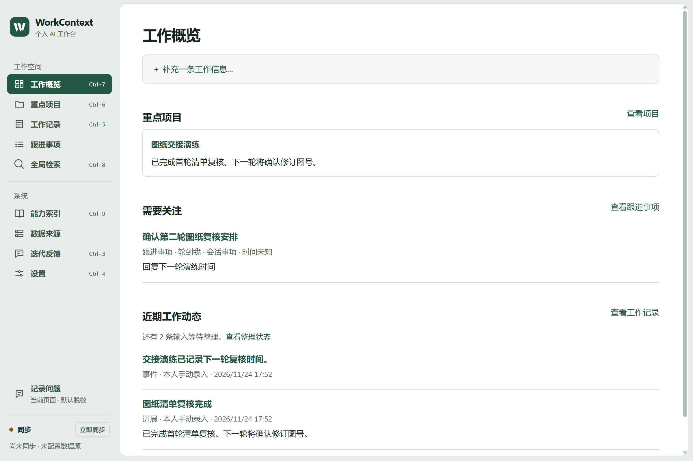
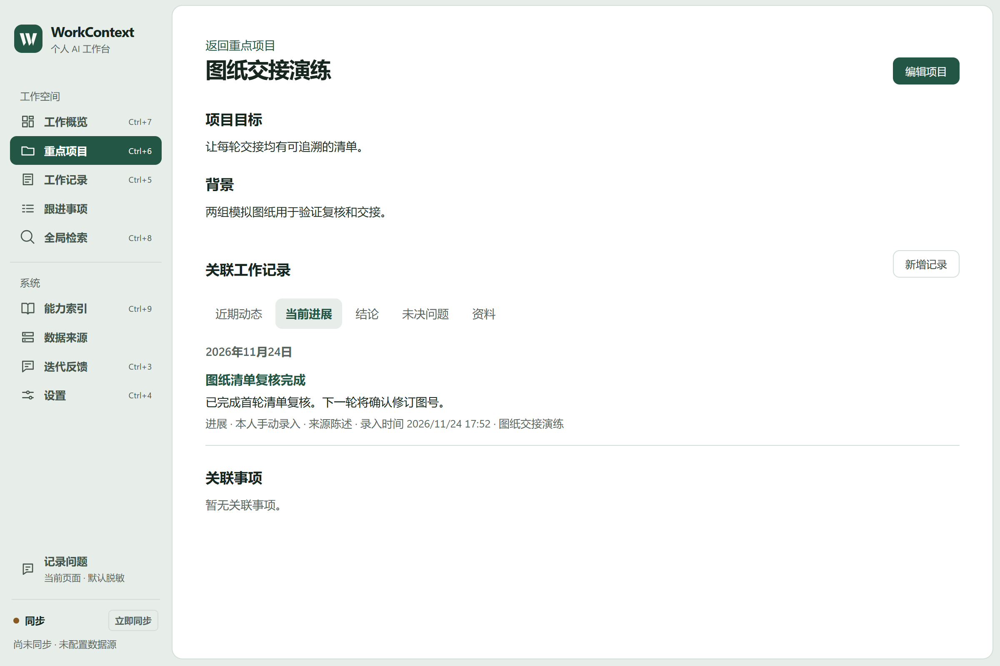
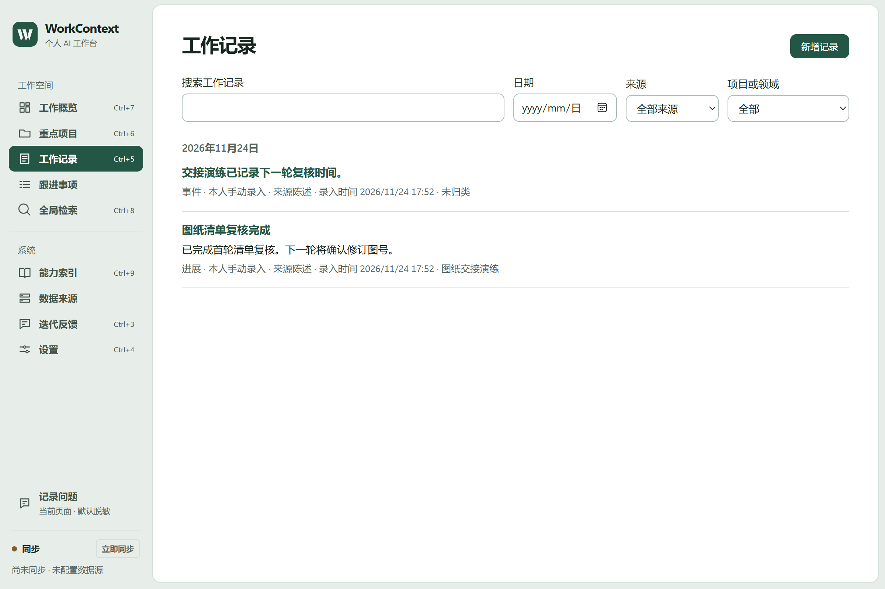
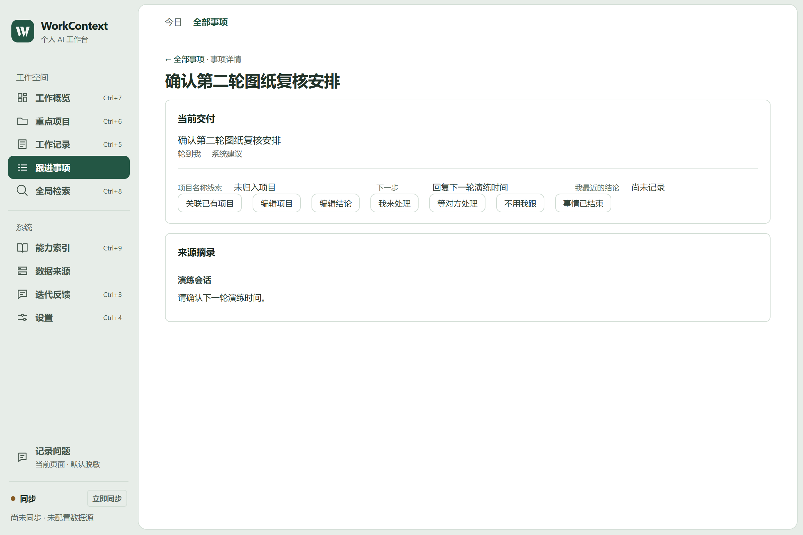
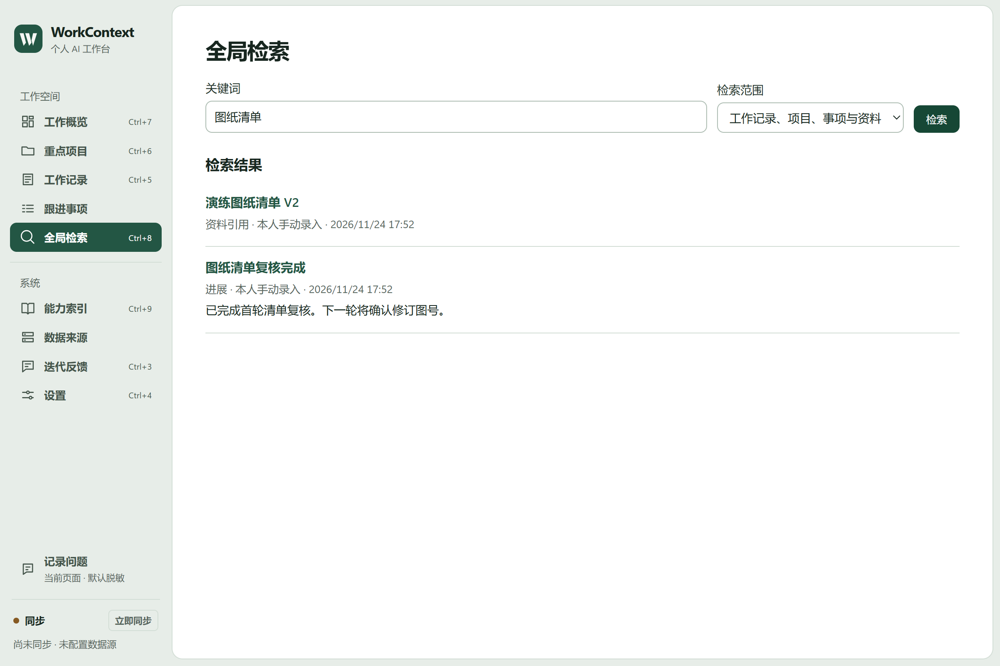
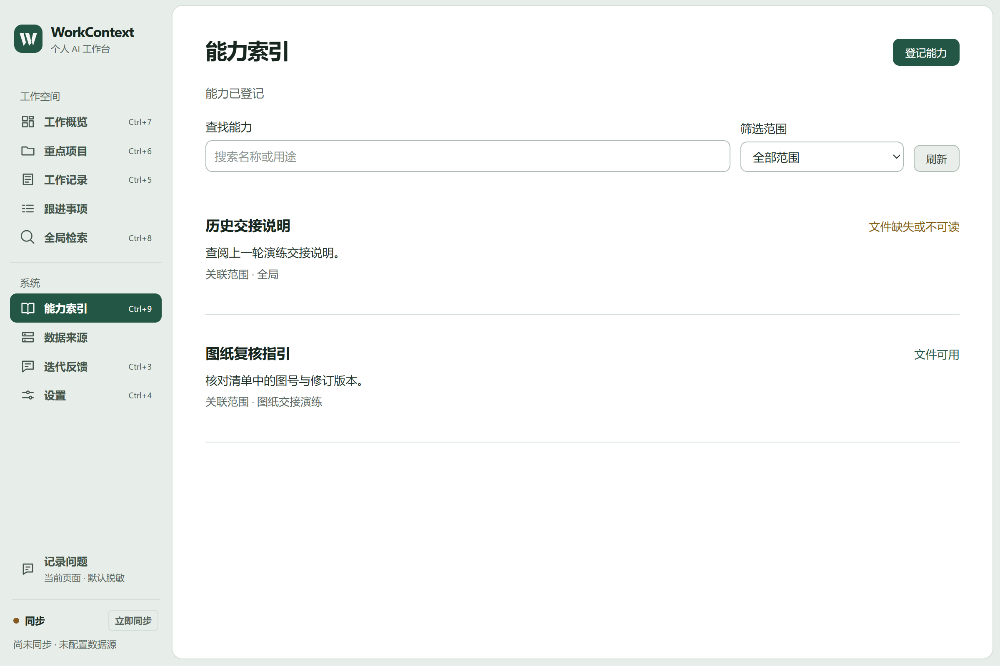
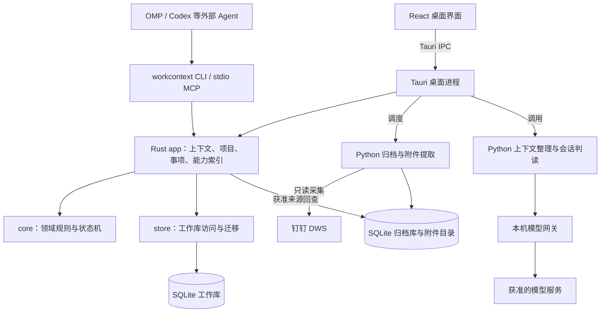
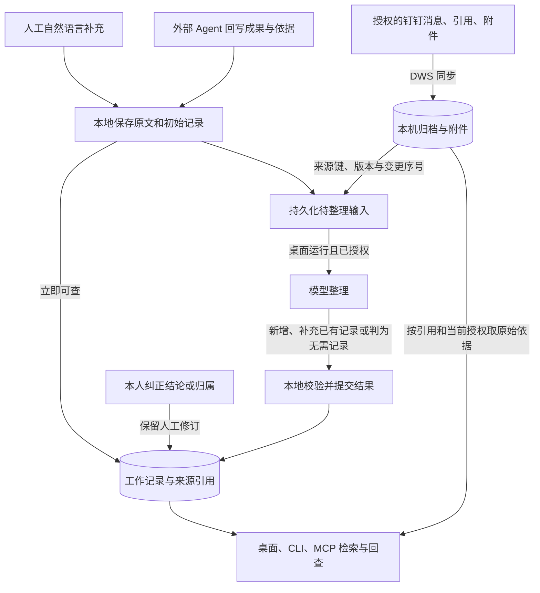
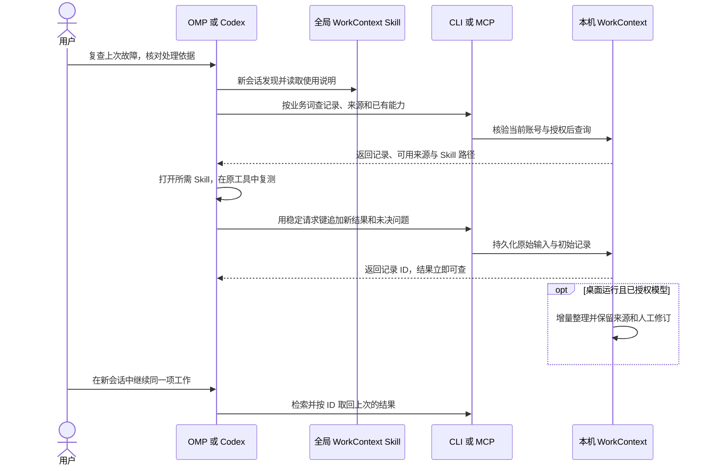

# WorkContext · 个人工作上下文中心

WorkContext 在本机保存工作经过，让你和下一次 AI 会话都能回答「上次怎么处理的，依据在哪里，还有什么没确认」。它适合主要在钉钉沟通、用 OMP 或 Codex 做事、又需要跨天跟进项目的人。一次故障排查可以只留一条经验；一个长期项目可以持续积累决定、资料和多批交付。

待办清单回答下一步轮到谁，知识库保存整理好的资料。WorkContext 把行动和资料连回当时的记录与消息，保留来源陈述、推断和人工结论。实际排查、编写代码或制作报告仍在你惯用的工具里完成，Agent 只需把值得复用的结果写回来。

[快速开始](#快速开始) · [外部 Agent 接入](#外部-agent-接入) · [开发指南](#开发指南) · [版本与验证范围](#当前版本状态)

## 核心功能

| 你要做的事 | WorkContext 提供的入口 |
| --- | --- |
| 留住沟通依据 | 通过钉钉 DWS 只读同步获准的消息、引用回复和附件。可按账号开启定时采集，查看附件下载与文字提取结果。 |
| 从消息中积累工作记录 | 经授权后，AI 按来源版本处理新增消息、迟到的附件摘录、人工补录和 Agent 成果。详情保留原始依据，分别呈现事实、推断和未决问题。 |
| 找回经验、补充或纠错 | 在「工作概览」直接输入自然语言；在「工作记录」和「全局检索」按业务词找回处理过程与资料。可更正正文、确认结论、调整或清空归属。 |
| 追踪项目及交付 | 「重点项目」汇集已确认的目标、背景、进展和历史；「跟进事项」按我来办、等对方、待我认领呈现当前动作。「全部事项」保留已收尾交付和人工结论。 |
| 让外部 Agent 接续工作 | 本地 CLI 和 stdio MCP 提供查询、来源回查、幂等追加与项目建议。「能力索引」按用途或范围查找已登记的 Skill，返回原始文件路径及可用状态。 |
| 在后台持续使用 | 窗口关闭后可驻留托盘，按授权继续采集和整理。可在设置中查看积压、重试时间，备份和恢复工作库。 |

## 界面预览

以下截图来自 Windows 原生窗口。六个页面使用同一组虚构的图纸交接资料，可以从首页追踪一次交付如何进入项目、记录和跟进清单。能力索引图已隐去本机文件路径。



<details>
<summary>展开查看重点项目、工作记录、跟进事项、全局检索和能力索引</summary>

**重点项目** · 同一项目下，已确认的目标和背景可与最近进展对照。



**工作记录** · 时间线按发生或记录时间回看，可按来源和归属筛选。



**跟进事项** · 打开具体交付，核对下一步和支持判断的会话摘录。



**全局检索** · 搜索「图纸清单」即可回到相应的工作记录。



**能力索引** · 查看已登记 Skill 的用途、适用范围和文件可用状态。



</details>

## 快速开始

### 在 Windows 上打开免安装版

1. **从源码生成 x64 免安装目录。** 在 Windows x64 MSVC 开发者 PowerShell 中按[开发指南](#开发指南)准备工具链，从仓库根目录运行 `& .\scripts\build-windows-release.ps1 -Portable`。脚本最后一行给出包含配套桌面和 CLI 的目录。
2. **启动桌面。** 确认 Microsoft Edge WebView2 Runtime 可用，保留同目录的 `archive-worker` 和 `fixtures`，双击 `workcontext-desktop.exe`。`workcontext.exe` 是配套 CLI。升级已有正式版前，从托盘退出并备份完整数据目录。
3. **先保存一条本地记录。** 在「工作概览」记下处理经过和仍待核实的问题，再到「全局检索」用其中的关键词找回它。这个流程可以离线使用，也可以留空项目和领域。首次绑定账号后，可从工作区选择器回看「绑定前的本机记录」。

### 接入钉钉、模型和外部工具

| 按需开启 | 首次配置与核对 |
| --- | --- |
| 钉钉归档 | 准备桌面进程可找到的 `dws.exe`。在终端执行 `dws auth login`、`dws auth status --readonly --format json` 核对企业和本人账号。在「设置 → 身份与模型」填本人稳定 userId，在「数据来源 → 来源与同步」登记 `corpId:userId`、来源及时间范围。「会话归档 → 立即同步全可访问会话」会开始真实采集；核对页面所示范围与最近成功时间后，可为该账号开启每 15 分钟同步。 |
| 附件与运行环境 | 归档与整理使用带 `sqlite3` 的 Python，推荐 Python 3.12。在源码根目录运行 `uv venv --python 3.12 .venv` 和 `uv pip sync --python .venv/Scripts/python.exe scripts/requirements-archive.txt` 安装附件读取依赖。把 `.venv\Scripts` 的绝对路径排在桌面进程 PATH 的其他 Python 之前；使用 OMP 时也须能找到 `omp.exe`。重启桌面使环境生效。 |
| AI 整理 | 准备本机网关 `http://127.0.0.1:3425/v1/chat/completions`，让桌面进程能读取 `WORKCONTEXT_REVIEW_API_KEY`。从托盘退出并重开，在「设置 → 身份与模型」选 **CLI** 和 `workbuddy/deepseek-v4.1-flash`，在「出域策略」批准该模型接收完整内容，最后在「工作上下文自动整理」核对范围并授权。 |
| 跟进清单 | 如需根据会话生成「今日」清单，到「设置 → 会话清单」单独确认近 30 天处理后会话的发送范围。也可在桌面选择「仅整理一次」。已有卡片可离线交接、收尾或纠错。 |
| 外部接口 | 在「设置 → 本地外部接口」选择当前已绑定账号并启用。读取脱敏钉钉归档需另外勾选。将同次构建的 CLI 加入用户 PATH，再从新的终端运行 `workcontext recent --limit 1 --json`；新工作区可以返回空列表。 |

关闭窗口后可以从托盘重新打开。选择「退出 WorkContext」会停止定时采集和模型整理，已授权的 CLI 和 MCP 仍可在本机检索和追加记录。下次启动桌面后会继续处理积压。

## 系统架构

WorkContext 是单机应用。桌面进程负责窗口、后台调度和数据库维护；外部工具由同一份 `workcontext` 可执行文件承接。两个入口共用 Rust 应用层，分别打开当前工作区的 SQLite 库。



### 核心数据流



采集需要能访问钉钉；保存原文、查询已入库内容、人工纠错和 Agent 回写均可离线完成。只有开启相应模型处理时，整理或会话判读才调用网关。网络或模型失败时，已接收的输入保留在队列中，可在设置里查看重试状态。

## 外部 Agent 接入

**CLI** 是本地命令入口；**MCP** 将同一组业务操作暴露为 stdio 工具；**全局 WorkContext Skill** 告诉 Agent 何时查询、何时回写，以及如何处理重复请求。能力索引里登记的其他 Skill 仍由各自的原文件维护。



### CLI 与 MCP

Windows PowerShell 中先运行 `(Get-Command workcontext -CommandType Application).Source` 核对正式 CLI 的路径，再运行 `workcontext --help`。下表左栏是 `workcontext` 后面的子命令；`--json` 提供版本化输出，ID 和来源引用使用上一次查询的返回值。

| CLI 子命令或示例 | MCP 工具 | 用途 |
| --- | --- | --- |
| `overview`、`recent --limit 5` | `overview`、`recent` | 看概览和近期记录 |
| `search "图纸"`、`records show ID` | `search`、`records_show` | 检索上下文、读取详情 |
| `projects list`、`projects show ID` | `projects_list`、`projects_show` | 查项目与已确认的目标、背景 |
| `messages search "复核"`、`source get REF` | `messages_search`、`source_get` | 搜本机获准归档、按引用回查依据 |
| `skills find Debug` | `skills_find` | 按名称或用途查 Skill 原始路径 |
| `records add --json`、`project suggest --json` | `records_add`、`project_suggest` | 从 stdin 追加成果或提交待确认的长期变更建议 |

例如，将以下内容保存为 UTF-8 的 `record.json`。`requestId` 标识这一次成果，同账号、同署名、同键、同内容的重试会返回原记录 ID；新证据另用新键。

```json
{
  "producer": "codex",
  "requestId": "drawing-review-001",
  "title": "图纸复核完成",
  "result": "已逐项核对清单和修订图，两个版本的孔位数量一致。",
  "openQuestions": ["装配现场是否已经换用修订图？"]
}
```

```powershell
$OutputEncoding = [Console]::OutputEncoding = [System.Text.UTF8Encoding]::new($false)
Get-Content -LiteralPath record.json -Raw -Encoding UTF8 | workcontext records add --json
```

`saved: true` 表示已经提交；`processingState: pending` 表示仍待整理。支持 `mcpServers` 的宿主可使用下列配置，将 `command` 换成刚核对过的绝对路径。其他宿主按各自格式设置相同的可执行文件和 `mcp` 参数。

```json
{
  "mcpServers": {
    "workcontext": {
      "command": "C:\\Tools\\WorkContext\\workcontext.exe",
      "args": ["mcp"]
    }
  }
}
```

### 安装全局 Skill，登记已有能力

从仓库根目录运行以下 PowerShell，给使用 `.agents/skills` 的宿主安装全局说明。已有文件时复制会停止，便于先核对版本。新开 Agent 会话后，可直接问「上次图纸复核还剩什么要确认？」。[全局 Skill 原文](skills/workcontext/SKILL.md)

```powershell
$skillDir = Join-Path $HOME '.agents/skills/workcontext'
New-Item -ItemType Directory -Force $skillDir | Out-Null
[System.IO.File]::Copy((Resolve-Path 'skills/workcontext/SKILL.md').Path, (Join-Path $skillDir 'SKILL.md'), $false)
```

要让 Agent 查到一项已有能力，在「能力索引 → 登记能力」填入名称、用途、原始 `SKILL.md` 的绝对路径及适用范围。例如，把自己的图纸复核说明登记为「图纸复核」，再运行 `workcontext skills find 图纸 --json`。核对结果的 `path` 和 `available` 后，Agent 可按需打开该文件。

## 数据与安全

正式工作区位于 Windows 的 `%APPDATA%\com.local.workcontext` 或 macOS 的 `~/Library/Application Support/com.local.workcontext`。开发版标识为 `com.local.workcontext.dev`，CLI 与桌面需使用匹配的构建。

| 数据 | 用途与保全范围 |
| --- | --- |
| `workcontext.sqlite3` | 项目、记录、原始补录与 Agent 输入、来源引用、事项、人工修订和整理状态。内置备份覆盖这个工作库。 |
| `archive/archive.sqlite3`、`archive/attachments/` | 归档消息、引用、附件元数据与提取结果，以及保存到磁盘的附件原件。完整备份需保全整个 `archive/`。 |
| `ownership/`、配置与 `backups/` | `ownership/latest.json` 保存会话清单报告；配置保存工作区设置与授权。`backups/` 保存工作库备份。迁移或回退前退出桌面、停止外部写入，保全整个工作区。 |

- **采集与模型各自授权。** 自动整理可向获准模型发送桌面补录、Agent 写入原文、授权消息和附件摘录。解释回复时可附获准的父消息；新版授权也允许同会话、同话题十分钟内紧邻的上一条。关联已有记录时可发送范围名称、记录标题、工单号与交付内容。会话清单有独立的近 30 天授权。
- **外部接口按请求核验。** CLI 和 MCP 访问当前绑定账号，消息检索与回查还受来源和脱敏归档授权约束。Agent 在远程模型会话中使用工具时，返回内容可能随会话离开本机，只应向获准的接收方提供任务所需的内容。
- **长期变更由本人确认。** Agent 可追加成果、关联已有范围、提出建项目或修改目标与背景的建议。建议需本人在桌面核对后才生效；外部工具不能代为批准、删除历史或覆盖人工结论。
- **恢复工作库。** 在「设置 → 本机维护」创建或选择备份。恢复时输入「恢复」并通过系统确认，程序校验备份并先备份当前库。迁移前也会生成工作库备份。回退到旧程序需使用与其 schema 匹配的库，另行还原对应的归档、附件、报告和配置。

## 技术栈与项目结构

桌面使用 Tauri 2 和系统 WebView；前端使用 React 18、TypeScript、Vite 和 TanStack Query。Rust 承担业务规则、IPC、CLI、调度和 SQLite 存取（`rusqlite`）。Python 承担归档、附件处理及模型请求。

```text
crates/
  core/       领域类型、状态机、校验规则
  store/      SQLite 连接、迁移、备份与恢复
  infra/      DWS、OMP、子进程与出域适配
  app/        项目与记录、跟进事项、能力索引、外部读写用例
  desktop/    Tauri 命令、托盘、后台任务与打包配置
  cli/        workcontext 命令及 stdio MCP 入口
ui/           桌面前端与组件测试
scripts/      Python 归档与整理程序、测试、Windows 发布与冒烟脚本
migrations/   工作库 SQL 迁移
fixtures/     样本与判读资源
skills/       供外部 Agent 发现的 WorkContext Skill
docs/images/  使用虚构交接资料的桌面截图
```

## 开发指南

从仓库根目录运行，推荐 Node.js 22、pnpm 10.29.3 和 Rust stable。Windows 需 x64 MSVC C++ 工具链、Windows SDK 和 WebView2；macOS 原生开发需 Xcode Command Line Tools。

```sh
pnpm install --frozen-lockfile
pnpm dev
```

`pnpm dev` 同时启动 Vite 和 Tauri 桌面开发版，适合联调 React、Rust 和 IPC。只调 UI 可用 `pnpm dev:web`；涉及数据库、后台任务或系统对话框的改动要在桌面窗口验证。配套开发 CLI 可用 `cargo run -p workcontext-cli --features dev-workspace -- --help`。

| 目的 | 从仓库根目录执行 |
| --- | --- |
| 前端类型检查与构建、组件测试 | `pnpm build`、`pnpm test` |
| Rust 静态检查、单元和集成测试 | `cargo clippy --locked --workspace -- -D warnings`、`cargo test --workspace` |
| Python 归档与整理测试 | 安装附件依赖后运行 `python -m unittest discover -s scripts -p 'test_*.py'` |
| Windows x64 正式配套发布 | 开发者 PowerShell 执行 `& .\scripts\build-windows-release.ps1 -Portable`；省略 `-Portable` 会尝试构建 NSIS 安装包 |
| macOS 应用包 | 在 macOS 运行 `pnpm exec tauri build --bundles app` |

Rust 集成测试位于各 crate 的 `tests/`，前端测试与组件同目录。

## 当前版本状态

| 平台或能力 | V0.1 的验证范围 |
| --- | --- |
| Windows x64 | V0.1 已在 Windows 原生桌面验证过窗口、托盘和配套 CLI。此仓库提供源码及免安装目录构建脚本；本次公开快照的 NSIS 安装向导尚未验证。 |
| macOS | Apple Silicon 上可从源码运行。正式签名、公证分发以及真实归档和模型整理的完整流程尚未在此公开快照验收。 |
| 整理质量 | 省略上下文的回复可能被漏掉，同一件事也可能留下多条记录。项目自动归类需要结合实际使用核对，可以从记录回查原始依据、纠正结论或归属。 |
| 部署范围 | 单机、单体架构，数据保存在当前系统用户的工作区。V0.1 暂不支持多设备同步。 |

## 源码导航与许可

[桌面与打包配置](crates/desktop) · [上下文与外部读写用例](crates/app) · [CLI 和 MCP](crates/cli) · [归档与模型脚本](scripts) · [Agent 使用说明](skills/workcontext/SKILL.md)

本仓库公开 V0.1 源码。Rust 工作区沿用 `Proprietary` 声明，项目未授予开源许可证。第三方依赖适用各自的许可证。[工作区清单](Cargo.toml)
